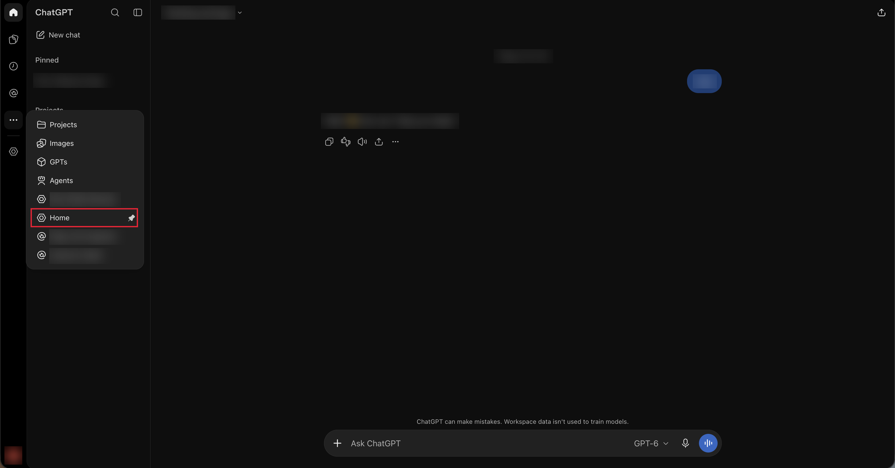

# Configurare le estensioni ChatGPT {#chatgpt-extensions}

>[!IMPORTANT]
>
>Le app LLM sono disponibili per tutti i clienti di AEM Sites Cloud Service che desiderano sviluppare e gestire le proprie app. Una volta avviato il conteggio, ogni chiamata all’app verrà conteggiata nelle richieste di contenuto AEM Sites del cliente. Adobe annuncerà il tasso di misurazione e la data di inizio prima che il conteggio abbia effetto.

**Si tratta di estensioni solo ChatGPT.** Non configurano funzionalità in [!DNL Claude] o altre piattaforme LLM. L’app può ancora funzionare su tali piattaforme tramite le azioni e i widget standard.

Utilizza le **[!UICONTROL estensioni ChatGPT]** per consentire alle persone di aprire direttamente l&#39;app, tenerla accanto a una conversazione, visualizzare i file supportati o trovare elementi durante la composizione di un messaggio.

**In questa guida:** Scopri come configurare queste funzioni facoltative e cosa possono essere utilizzate dagli utenti. Un catalogo di prodotti è l’esempio; abilita solo le funzioni necessarie per l’app.

I contorni rossi nelle schermate evidenziano i controlli utilizzati nei passaggi. Si tratta di annotazioni della documentazione, non di indicatori di errore dell’interfaccia utente.

## Prima di iniziare {#before-you-begin}

Hai bisogno di:

- Un&#39;app LLM esistente, l&#39;autorizzazione a modificarne le azioni e un&#39;azione di lavoro per l&#39;attività.
- Un widget pubblicato per l’apertura diretta o la visualizzazione di file. Le azioni di solo testo possono fornire la ricerca di menzioni, ma non punti di ingresso.
- `@adobe/llm-apps-runtime` 1.3.0 e, per le funzionalità del widget, `@adobe/llmapps-sdk` 0.2.1 o versioni successive supportate. Chiedi al gestore dell&#39;app di confermare entrambe le versioni e, se necessario, aggiornare gli script del widget servito.
- Un&#39;app connessa e un client che supporta l&#39;estensione selezionata.

>[!IMPORTANT]
>
>La disponibilità varia in base al client. I punti di ingresso dei file sono **solo desktop**; le menzioni del compositore richiedono **desktop o il browser di lavoro**. La colonna Supporto Web di OpenAI esclude [!DNL ChatGPT] classico. Controlla il supporto di [piattaforma](https://github.com/openai/mcp-extensions/blob/main/docs/spec.md#platform-support) prima di eseguire il test.

>[!IMPORTANT]
>
>Le impostazioni **non** generano un visualizzatore di file o implementano la ricerca. Chiedi al tuo maintainer di preparare prima l&#39;[azione](/help/guides/customize-handler.md) e il [widget](/help/guides/widgets.md) richiesti.

## Apri estensioni ChatGPT {#open-extensions}

1. Apri l&#39;app e seleziona **[!UICONTROL Azioni]**.
1. Apri l’azione da configurare.
1. Selezionare la scheda **[!UICONTROL Estensioni ChatGPT]**.

La scheda è disponibile anche durante la creazione dell’azione. Questa guida utilizza un’azione esistente rivista.

Seleziona **[!UICONTROL Salva modifiche]** dopo la modifica. Per pubblicare la configurazione, segui [Distribuisci l&#39;app](/help/guides/deploy-your-app.md) e [aggiorna la connessione ChatGPT](/help/guides/test-in-chatgpt.md#refresh-after-app-changes).

## Scegli dove le persone aprono la tua app {#configure-entrypoints}

Un **entrypoint** è un luogo in cui le persone aprono l&#39;app senza chiedere al modello di richiamarla.

>[!NOTE]
>
>È possibile selezionare più punti di ingresso per lo stesso widget. I punti di ingresso forniscono modi aggiuntivi per aprirlo; non sostituiscono la normale chiamata in chat. Quando l’azione è disponibile per il modello, le persone possono ancora chiederla in chat e riceverne il widget.

1. In **[!UICONTROL Entrypoints]**, immettere facoltativamente un URL immagine HTTPS pubblico nell&#39;**[!UICONTROL URL icona]**. L&#39;icona è condivisa dai punti di ingresso di questa azione; usa un&#39;immagine che puoi pubblicare.
1. In **[!UICONTROL Dove gli utenti possono aprire questa app]**, selezionare una combinazione delle caselle di controllo seguenti per lo stesso widget. Lascia deselezionato tutto se l’azione non richiede l’apertura diretta.

   | Tipo | Risultato |
   |---|---|
   | **[!UICONTROL Globale]** | Apri il catalogo a schermo intero dalla navigazione |
   | **[!UICONTROL Thread]** | Apri il catalogo come scheda accanto a una conversazione |
   | **[!UICONTROL File]** | Apri i file corrispondenti nel visualizzatore personalizzato |

1. Per Global o Thread, conferma che l’azione funzioni senza gli input richiesti.
1. Per File, completare l&#39;impostazione seguente.

Ad esempio, seleziona sia Globale che Thread per aprire lo stesso widget catalogo dalla navigazione o accanto a una conversazione. È inoltre possibile selezionare File se il widget supporta la visualizzazione dei file. Quando File viene combinato con Global o Thread, lasciare deselezionato **[!UICONTROL Required]** per l&#39;input `file`: gli avvii dei file forniscono ancora l&#39;oggetto file, ma l&#39;avvio Global e Thread non contiene input. Il gestore e il widget devono supportare entrambi i casi. Un&#39;azione solo file può richiedere `file`.

**Risultato previsto:** Aprire il catalogo dalla navigazione per Global o come scheda lato conversazione per Thread.

### Apri da navigazione o conversazione {#test-global-thread}

Le schermate seguenti fornite dall&#39;utente illustrano il dashboard **Home** anziché l&#39;esempio del catalogo. La navigazione e il posizionamento del menu possono variare a seconda del client.

Per **Global**, apri il menu di navigazione e seleziona il punto di ingresso dell&#39;app. In questo esempio, il punto di ingresso è **Home**.

Verifica che il dashboard venga aperto a schermo intero, con la barra di navigazione ancora disponibile.

Per **Thread**, apri il menu di conversazione, seleziona **[!UICONTROL Plug-in]** e scegli il punto di ingresso. Confermate che il widget si apra accanto alla conversazione senza bisogno di un nuovo prompt.

### Aprire un file supportato nell’app {#file-entrypoint}

Per un visualizzatore catalogo CSV preparato:

1. Selezionare la casella di controllo **[!UICONTROL File]**, selezionare **[!UICONTROL Aggiungi estensione]** e immettere `.csv`. Aggiungi ogni estensione supportata nel proprio campo.
1. In **[!UICONTROL Dettagli azione]** > **[!UICONTROL Parametri di input]**, confermare un parametro **Oggetto** denominato `file` che accetta `name` e `resourceUri`. Se si seleziona File, viene aggiunto un input Object facoltativo se non esiste alcun parametro `file`. Verificare le definizioni esistenti. Non sono richiesti altri ingressi. Mantieni `file` facoltativo se è selezionato anche Global o Thread.
1. In un client desktop supportato, aprire un file `.csv` non sensibile con l&#39;app.

**Risultato previsto:** Il widget visualizza il file. Per salvare le modifiche è inoltre necessario implementare il supporto per la modifica e un file scrivibile.

>[!IMPORTANT]
>
>I punti di ingresso dei file sono diversi dai parametri dei file caricati. Ricevono un riferimento alla risorsa del file aperto, non un URL di download del caricamento o un ID file.

## Scegli come viene visualizzata l’app {#display-settings}

In **[!UICONTROL Modalità di visualizzazione]**:

1. Imposta **[!UICONTROL Visualizzazione quando avviato dal modello]** su `inline`, `fullscreen` o **[!UICONTROL Nessuna preferenza]**.
1. Selezionare le **[!UICONTROL modalità di visualizzazione delle risorse supportate dal widget]**: In linea, Schermo intero o entrambe. Lascia entrambe deselezionate per utilizzare i valori predefiniti dell&#39;host.
1. Scegliere **[!UICONTROL Visualizzazione risorsa iniziale]**. Se hai selezionato le modalità supportate, devi includere la modalità iniziale.

Queste sono le preferenze; [!DNL ChatGPT] sceglie la presentazione finale. Schermo intero non crea una scheda del pannello laterale: utilizza un punto di ingresso Thread per tale scheda.

Verifica che il widget rimanga utilizzabile in ogni modalità pubblicizzata.

## Consenti alle persone di trovare le risorse nel compositore {#composer-mentions}

Le menzioni del compositore consentono agli utenti di cercare e selezionare gli elementi del catalogo durante la scrittura di un messaggio. Utilizza un’azione che restituisce già risultati di ricerca selezionabili.

1. Apri l&#39;azione di ricerca e seleziona **[!UICONTROL Dettagli azione]**.
1. Confermare un input **String** denominato `query` che accetta testo vuoto, senza altri input richiesti.
1. In **[!UICONTROL Impostazioni LLM]**, abilita **[!UICONTROL Suggerimento di sola lettura]** e **[!UICONTROL Visualizza come widget nella superficie dell&#39;app]**. L&#39;azione di ricerca deve essere di sola lettura.
1. In **[!UICONTROL ChatGPT Extensions]**, attivare **[!UICONTROL Abilita menzioni compositore]**.
1. È consentito un solo provider per app. In caso di sostituzione, disattiva le menzioni sul provider precedente e salvalo prima di abilitare il nuovo provider.

**Risultato previsto:** Cerca un prodotto noto nella ricerca di menzione del compositore dell&#39;app, selezionalo e conferma che il messaggio faccia riferimento alla risorsa prevista.

L’impostazione di visibilità rende l’azione di ricerca disponibile per l’app. Il provider non ha bisogno del proprio widget visivo.

Nell&#39;esempio seguente viene utilizzato **Search Mentions**, un&#39;azione di solo testo che esegue ricerche nei documenti sintetici anziché nel catalogo. L&#39;input `query` è una **stringa** con **Elemento obbligatorio** deselezionato.

Nella scheda **[!UICONTROL Estensioni ChatGPT]** della stessa azione, è attiva **[!UICONTROL Abilita menzioni compositore]**.

Se un’altra azione già fornisce la ricerca delle menzioni, l’interruttore non è disponibile e un avviso identifica tale azione. Disattiva le menzioni sul provider esistente e salva prima di abilitare una sostituzione.

## Funzioni aggiuntive del widget ChatGPT {#additional-widget-features}

SDK supporta anche collegamenti profondi specifici per ChatGPT, contesto di selezione esteso, bozze modificabili e targeting delle conversazioni. Questi richiedono l’implementazione del widget, non un altro switch in questa scheda.

| Se il widget fornisce | Prova |
|---|---|
| Collegamento a un elemento | Apri il collegamento e conferma che venga visualizzato il prodotto desiderato |
| Contesto di selezione | Seleziona un prodotto non sensibile e fai una domanda al riguardo |
| Controllo bozza o nuova conversazione | Conferma l’apertura del messaggio dove previsto e una bozza non viene inviata automaticamente |

I messaggi di base dei widget e altre API standard di SDK non sono solo ChatGPT. Chiedi al tuo responsabile quali estensioni implementa il widget; consulta la [documentazione di SDK](https://www.npmjs.com/package/@adobe/llmapps-sdk).

## Modificare o rimuovere un’estensione {#change-or-remove}

Nella stessa scheda, deselezionare la casella di controllo del punto di ingresso o disattivare **[!UICONTROL Abilita menzioni compositore]**. Deseleziona File se non rimangono estensioni. Per rimuovere l&#39;icona condivisa, selezionare **[!UICONTROL Cancella icona]**. Per ripristinare i valori predefiniti di visualizzazione, selezionare **[!UICONTROL Nessuna preferenza]**, cancellare le modalità supportate e selezionare **[!UICONTROL Host predefinito]**.

La rimozione di un punto di ingresso non comporta l&#39;eliminazione dell&#39;azione o dei file utente. Vedi [definizioni e regole dei campi](/help/reference/reference-docs.md#chatgpt-extension-fields).

## Risoluzione di problemi {#troubleshooting}

| Cosa vedi | Cosa fare |
|---|---|
| Funzionalità o controlli mancanti | Controlla [supporto client](#before-you-begin). Per i punti di ingresso, conferma che sia configurato un widget. Queste estensioni non si applicano a Claude o ad altri host |
| Salvare i rapporti con un input richiesto non compatibile | Global/Thread non fornisce input, File fornisce `file` e menziona la fornitura `query`. Chiedi al manutentore di risolvere la mancata corrispondenza; non rimuovere un input necessario per l’azione |
| Errore durante l&#39;installazione o la visualizzazione del file | Aggiungere un&#39;estensione supportata, confermare l&#39;input Oggetto `file` e utilizzare un client desktop compatibile. Il widget deve implementare tale formato di file |
| Salvataggio file non riuscito | Conferma il supporto per la modifica e l’autorizzazione di scrittura. Risolvere i conflitti anziché sovrascrivere i contenuti più recenti; ridurre i contenuti di dimensioni eccessive |
| Impossibile salvare l’URL dell’icona | Inserisci un URL immagine o un URI dati valido oppure cancella l’icona opzionale. Preferisci un URL immagine HTTPS pubblico |
| Impostazione di visualizzazione rifiutata o ignorata | Includi la modalità iniziale tra le modalità supportate. ChatGPT controlla la presentazione finale |
| Le menzioni non possono essere abilitate | Verificare il comportamento di sola lettura, la visibilità dell&#39;app e l&#39;input `query`. Salva la rimozione del provider precedente prima di abilitarne la sostituzione |
| La ricerca non restituisce alcun elemento o un errore | Prova con un elemento noto. I risultati vuoti possono essere validi; segnala gli elementi noti mancanti o gli errori al gestore di ricerca |
| Impossibile caricare le azioni | Utilizza **[!UICONTROL Riprova a caricare le azioni dell&#39;app]** o **[!UICONTROL Aggiorna azioni dell&#39;app]** quando offerti |
| Creazione bozza non riuscita | Controlla il supporto client. Non inviare automaticamente un messaggio inteso come bozza |
| Mancano le modifiche salvate | Distribuisci nell’ambiente testato, aggiorna la connessione e conferma la pubblicazione delle modifiche al widget |
| Salvataggio dei blocchi di entrypoint delle impostazioni non supportato | Selezionare le caselle di controllo Global, Thread o File supportate oppure lasciare deselezionato tutto |

Per supporto, registra l’app, l’ambiente, il client, il passaggio non riuscito e l’errore visibile. Non includere token, URL privati o dati sensibili.

## Passaggio successivo {#whats-next}

- [Distribuire l’app](/help/guides/deploy-your-app.md)
- [Testare l’app LLM come plug-in ChatGPT](/help/guides/test-in-chatgpt.md)
- [Personalizzare un widget generato](/help/guides/widgets.md)
