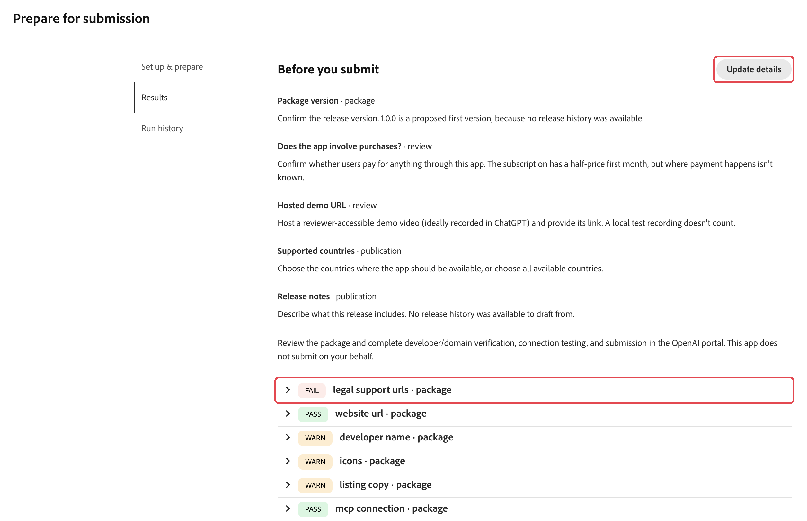

# Prepara l’app per l’invio di ChatGPT {#prepare-submission}

>[!IMPORTANT]
>
>Le app LLM sono disponibili per tutti i clienti di AEM Sites Cloud Service che desiderano sviluppare e gestire le proprie app. Una volta avviato il conteggio, ogni chiamata all’app verrà conteggiata nelle richieste di contenuto AEM Sites del cliente. Adobe annuncerà il tasso di misurazione e la data di inizio prima che il conteggio abbia effetto.

Per elencare l&#39;app nella directory del plug-in [!DNL ChatGPT], carica un pacchetto di invio in OpenAI. [!DNL LLM Apps] ti aiuta a prepararlo. Crea il file ZIP del pacchetto dall’app, invia richieste di test all’app implementata e registra i risultati in modo da poterli controllare. Quindi carica il pacchetto e completa l’invio nel portale OpenAI.

**In questa guida:** scopri come preparare un pacchetto di invio per la tua app in [!DNL LLM Apps] e cosa fare successivamente nel portale OpenAI.

>[!NOTE]
>
>[!DNL LLM Apps] non invia l&#39;app a OpenAI. La verifica per sviluppatori e domini, il test di connessione, la revisione e la pubblicazione avvengono nel portale OpenAI. Consulta [Caricare e inviare il plug-in](https://developers.openai.com/plugins/deploy/submission).

## Prima di iniziare

- [Distribuisci l&#39;app](/help/guides/deploy-your-app.md) in **Produzione**. [!DNL LLM Apps] invia le richieste di test alla versione di produzione dell&#39;app.
- Assicurati che le azioni da pubblicare siano riviste e abilitate.
- Assicurati che il nome dell’editore sia pronto e che gli URL della pagina di supporto, dell’informativa sulla privacy e dei termini del servizio siano pronti.
- Disporre di due icone: un logo e un&#39;icona del compositore. Ciascuno deve essere un PNG quadrato, non animato, 64-4096 pixel per lato, e non più grande di 1 MB. Utilizzare solo le immagini per le quali si dispone dell&#39;autorizzazione per la pubblicazione.
- Se l&#39;app [autentica gli utenti finali](/help/guides/authentication.md), registra un client OAuth per [!DNL ChatGPT] nel provider di identità, a meno che il provider di identità non supporti DCR (Dynamic Client Registration) o CIMD (Client ID Metadata Documents).

## Apri Preparazione per l’invio

Dopo aver distribuito l&#39;app in produzione per la prima volta, la pagina dell&#39;app mostra la scheda **[!UICONTROL Prepara per l&#39;invio]** sotto **[!UICONTROL Verifica l&#39;app]**.

Selezionare **[!UICONTROL Configurazione]**. Successivamente, il pulsante sulla scheda cambia per mostrare il passaggio successivo, ad esempio **[!UICONTROL Visualizza avanzamento]** o **[!UICONTROL Visualizza risultati]**.

Viene visualizzata la finestra di dialogo **[!UICONTROL Preparazione per l&#39;invio]**. Sono disponibili tre sezioni: **[!UICONTROL Configurazione e preparazione]**, **[!UICONTROL Risultati]** e **[!UICONTROL Cronologia esecuzioni]**.

## Aggiungi i dettagli dell’invio

In **[!UICONTROL Configurazione e preparazione]**:

1. In **[!UICONTROL Editore e legale]**, immettere **[!UICONTROL Nome editore]**, **[!UICONTROL URL supporto]**, **[!UICONTROL URL criteri di privacy]** e **[!UICONTROL URL termini servizio]**.
   - Per **[!UICONTROL Nome editore]**, immettere il nome pubblico che verrà verificato come editore nel portale OpenAI.
   - Per **[!UICONTROL URL supporto]**, immettere l&#39;URL di una pagina di supporto o di contatto. Un indirizzo e-mail non è accettato.
   - L&#39;informativa sulla privacy deve descrivere i dati che l&#39;app, l&#39;autenticazione, il widget e l&#39;analisi raccolgono e utilizzano.
2. In **[!UICONTROL Icone approvate]**, selezionare **[!UICONTROL Scegli logo]**, quindi **[!UICONTROL Scegli icona compositore]** e scegliere un file PNG per ciascuno di essi.
3. Se l&#39;app utilizza l&#39;autenticazione, apri **[!UICONTROL Registrazione client OAuth]** e scegli come [!DNL ChatGPT] ottiene un client OAuth. Scegli solo un’opzione supportata dal provider di identità:
   - **[!UICONTROL Fornito]** - hai registrato un client per [!DNL ChatGPT]. Immetti il relativo **[!UICONTROL ID client registrato]**. Non inserire l’ID client Adobe IMS.
   - **[!UICONTROL DCR]** - [!DNL ChatGPT] registra un client utilizzando la registrazione client dinamica.
   - **[!UICONTROL CIMD]** - [!DNL ChatGPT] si identifica con un documento di metadati ID client.

   [!DNL LLM Apps] non richiede mai un segreto client.
4. Facoltativamente, apri **[!UICONTROL Ulteriori dettagli sull&#39;invio]** e immetti il testo dell&#39;inserzione, il nome e la versione del pacchetto, i dettagli dell&#39;acquisto, l&#39;URL della demo in hosting, i paesi supportati e le note sulla versione. Se si lascia vuoto un campo, [!DNL LLM Apps] crea il testo dove è possibile. Tutto ciò che non può essere bozza viene visualizzato più tardi in **[!UICONTROL Prima dell&#39;invio]**.
5. Seleziona **[!UICONTROL Salva modifiche]**.

La preparazione utilizza solo i dettagli e le icone salvati.

>[!TIP]
>
>I revisori OpenAI hanno bisogno di un video dimostrativo della tua app, idealmente registrato in [!DNL ChatGPT], con un URL da poter aprire. La registrazione di prova da [!DNL LLM Apps] è a scopo di verifica e non sostituisce questa demo. Registra la demo, caricala in una posizione accessibile ai revisori e immetti il relativo URL in **[!UICONTROL URL demo ospitato]** prima di preparare il pacchetto.

## Preparare il pacchetto

In **[!UICONTROL Prepara il pacchetto]**, controlla **[!UICONTROL Preparazione]**. **[!UICONTROL Pronto per la preparazione]** significa che i dettagli salvati soddisfano i requisiti. In caso contrario, nella sezione vengono elencati gli elementi mancanti, ad esempio i dettagli richiesti o una distribuzione di produzione riuscita.

1. Leggi **[!UICONTROL Cosa succede durante la preparazione]**. [!DNL LLM Apps] crea il pacchetto e invia le richieste di test all&#39;app distribuita. L’operazione può richiedere alcuni minuti e le richieste di test possono essere visualizzate nell’analisi dell’app.
2. Seleziona **[!UICONTROL L&#39;app distribuita verrà chiamata per preparare le prove di revisione.]** casella di controllo.
3. Selezionare **[!UICONTROL Prepara pacchetto]**.

Durante l&#39;esecuzione della preparazione, nella finestra di dialogo viene visualizzato **[!UICONTROL Preparazione in corso]**. [!DNL LLM Apps] utilizza l&#39;app e i dettagli come quando hai selezionato **[!UICONTROL Prepara pacchetto]**.

Puoi chiudere la finestra di dialogo e tornare in un secondo momento. La preparazione continua in background e la scheda nella pagina dell&#39;app mostra **[!UICONTROL Preparazione del pacchetto]** fino al termine. Se la preparazione non riesce, i dettagli salvati vengono conservati.

## Esaminare i risultati

Al termine della preparazione, apri **[!UICONTROL Risultati]**. Nella parte superiore della sezione viene riepilogato il risultato. **[!UICONTROL La preparazione richiede attenzione]** significa che [!DNL LLM Apps] ha creato un pacchetto bozza ma ha rilevato problemi che è necessario risolvere prima, ad esempio i collegamenti legali dei segnaposto.

- **[!UICONTROL Pacchetto e report]** - seleziona **[!UICONTROL Scarica pacchetto]** per ottenere il file ZIP di invio e **[!UICONTROL Scarica report]** per ottenere il report di preparazione. **[!UICONTROL Il pacchetto di download]** è disponibile solo quando la preparazione produce un pacchetto completo.
- **[!UICONTROL Rivedi le registrazioni]** - seleziona **[!UICONTROL Scarica la registrazione]** e guarda il video per verificare che l&#39;app si comporti come previsto. Un video può includere diversi casi di test.
- **[!UICONTROL Casi di test]**: per ogni caso di test, controlla la richiesta inviata e il relativo stato. Apri **[!UICONTROL Comportamento previsto]** per visualizzare le operazioni dell&#39;app. Alcuni casi di test richiedono elementi non supportati dall’app. Per questi, l’app deve rifiutare la richiesta senza chiamare un’azione.

Le registrazioni provengono dall&#39;ambiente di test [!DNL LLM Apps]. Non significa che [!DNL ChatGPT] abbia verificato la tua app o che OpenAI l&#39;abbia approvata.

**[!UICONTROL Prima dell&#39;invio]** elenca i dettagli da confermare o immettere, ad esempio la versione del pacchetto, se l&#39;app prevede acquisti, l&#39;URL della demo ospitata, i paesi supportati e le note sulla versione. Sotto l&#39;elenco, ogni controllo mostra **PASS**, **WARN** o **FAIL**. Espandi una spunta per visualizzare i dettagli. Per correggere un dettaglio, selezionare **[!UICONTROL Aggiorna dettagli]**, salvare le modifiche e preparare di nuovo il pacchetto.

Se modifichi l&#39;app o i dettagli dopo la preparazione, **[!UICONTROL Risultati]** mostra **[!UICONTROL App o input modificati dopo questa esecuzione]**. Seleziona **[!UICONTROL Prepara di nuovo]** per creare un nuovo pacchetto dall&#39;app corrente e dai dettagli. **[!UICONTROL Cronologia esecuzioni]** elenca i preparativi precedenti. L’apertura di un elemento non modifica i dettagli salvati.

## Invia nel portale OpenAI

Una volta completato il pacchetto, scaricalo e segui [Carica e invia il tuo plug-in](https://developers.openai.com/plugins/deploy/submission) nella documentazione di OpenAI all&#39;indirizzo:

1. Carica il file ZIP e correggi eventuali problemi rilevati dai controlli automatici.
2. Connetti il server MCP e completa la verifica del dominio.
3. Inserisci le informazioni di revisione, inclusi i dettagli di accesso per i revisori, se l&#39;app richiede l&#39;accesso, e invia l&#39;app per la revisione.
4. Pubblica il plug-in approvato.

Per verificare il dominio:

1. Dopo aver caricato il pacchetto, copia il token di sfida visualizzato nel portale OpenAI.
2. In [!DNL LLM Apps], apri le **[!UICONTROL Impostazioni]** > **[!UICONTROL Invio]** dell&#39;app.
3. In **[!UICONTROL Verifica dominio]**, incolla il token in **[!UICONTROL OpenAI challenge token]** e seleziona **[!UICONTROL Salva]**.
4. [Distribuisci nuovamente l&#39;app](/help/guides/deploy-your-app.md) in produzione. Il token viene pubblicato solo dopo la distribuzione successiva.
5. Torna al portale OpenAI e completa la verifica.

[!DNL LLM Apps] fornisce il token in `/.well-known/openai-apps-challenge` sul dominio dell&#39;app, quindi non è necessario ospitarlo personalmente.

### Suggerimenti per una revisione senza problemi

- **Controllare l&#39;autenticazione di ogni azione.** Quando il portale OpenAI esegue la scansione del server MCP, chiama ogni azione. Se un’azione è contrassegnata come richiedente l’autenticazione ma la chiamata non può essere autenticata, l’analisi non riesce. Quindi devi correggere l’app, preparare un nuovo pacchetto e caricarlo di nuovo.
- **Tempo consentito per la revisione.** Dopo l’invio, OpenAI rivede l’app prima che sia possibile pubblicarla e invia un feedback tramite e-mail. Tieni conto di questo periodo di tempo quando pianifichi la data di rilascio.
- **Carica un nuovo pacchetto quando vengono elencati i dettagli che cambiano.** Dopo la pubblicazione, [!DNL ChatGPT] rileva automaticamente le modifiche al server MCP quando si ridistribuisce. Le modifiche ai dettagli dell’elenco o ad altri metadati del pacchetto richiedono un nuovo pacchetto. Preparalo di nuovo in [!DNL LLM Apps] e caricalo nel portale OpenAI.

## Correlato

- [Distribuire l’app](/help/guides/deploy-your-app.md)
- [Testare l’app LLM come plug-in ChatGPT](/help/guides/test-in-chatgpt.md)
- [Configurare le estensioni ChatGPT](/help/guides/chatgpt-extensions.md)
